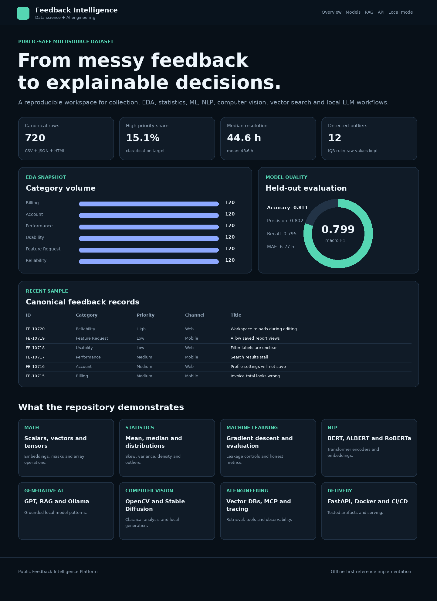

# Public Feedback Intelligence Platform

An end-to-end data science, data collection and AI engineering portfolio project. It collects deliberately messy public-safe feedback from CSV, nested JSON and HTML; creates a traceable canonical dataset; runs EDA and statistical analysis; trains classification, regression, clustering and anomaly-detection models; builds a local semantic index and evidence-labelled RAG workflow; evaluates image quality with OpenCV; and serves the results through FastAPI and lightweight dashboards.

The core is offline-first. It does not need a paid API, private account, cloud subscription or downloaded language model.



## Working scope

| Area | Included implementation |
| --- | --- |
| Data collection | CSV, JSON and HTML collectors with source provenance and duplicate handling |
| Data engineering | Pandas/NumPy transformations, validation, missing values, outlier flags, SQLite and SQL checks |
| EDA and statistics | Matplotlib, Seaborn, distributions, skew, variance, standard deviation, density, mean/median and correlations |
| Machine learning | scikit-learn priority classifier, resolution-time regressor, K-means clustering and Isolation Forest |
| Evaluation | Accuracy, precision, recall, macro-F1, confusion matrix, MAE, RMSE, R-squared and leakage controls |
| NLP and retrieval | TF-IDF, dense SVD embeddings, cosine similarity, Euclidean distance, local vector search and grounded responses |
| Computer vision | OpenCV measurements for exposure, contrast, blur, sharpness and noise |
| API and apps | FastAPI, static dashboard, Streamlit and Gradio examples |
| AI engineering | Optional Ollama, Hugging Face, LangChain, LlamaIndex, CrewAI, Chroma, Qdrant and MCP adapters |
| MLOps | Model/data cards, MLflow, W&B and Langfuse examples, Docker, GitHub Actions and Azure Pipelines |
| Foundations | Scalars, vectors, matrices, tensors, embeddings, masks, gradient descent, ANN/NN and transformer notes |

## Architecture

```text
CSV / nested JSON / HTML
            |
            v
collect -> normalize -> validate -> canonical CSV + SQLite
            |                         |
            |                         +-> EDA and statistical reports
            +-> supervised ML --------+-> model artifacts and metrics
            +-> text corpus ----------+-> embeddings -> retrieval -> local RAG
            +-> image samples --------+-> OpenCV quality report
                                                |
                                                v
                                      FastAPI + dashboards
```

## Quick start

Python 3.11 or newer is recommended.

```bash
python -m venv .venv
```

Activate it:

```powershell
# Windows PowerShell
.venv\Scripts\Activate.ps1
```

```bash
# Linux or macOS
source .venv/bin/activate
```

Install the core and run the checks:

```bash
python -m pip install --upgrade pip
python -m pip install -r requirements.txt
python -m pip install -e .
pytest -q
python scripts/validate_repository.py
```

Rebuild every deterministic artifact:

```bash
python scripts/run_pipeline.py
```

Start the API:

```bash
uvicorn feedback_intelligence.api:app --host 127.0.0.1 --port 8000
```

Open:

- Dashboard: `http://127.0.0.1:8000/dashboard`
- OpenAPI documentation: `http://127.0.0.1:8000/docs`

## Repository map

```text
apps/                       optional Streamlit and Gradio interfaces
artifacts/database/         generated SQLite database
artifacts/figures/          EDA charts
artifacts/models/           compact scikit-learn and retrieval artifacts
artifacts/reports/          metrics, data-quality and dashboard outputs
data/raw/                    deterministic CSV, JSON and HTML exports
data/processed/              canonical analytical dataset
data/knowledge/              local retrieval corpus
docs/                        architecture, concepts, model cards and decisions
examples/                    focused optional framework examples
notebooks/                   five executed learning notebooks
scripts/                     pipeline, validation and smoke-test commands
sql/                         schema, quality checks and analytical queries
src/feedback_intelligence/   reusable application package
tests/                       unit, integration, API and repository tests
```

## Optional frameworks

The default requirements stay reviewable. The broader curriculum examples are isolated under `examples/` and `apps/`. Install them only for the experiment being run:

```bash
python -m pip install -r requirements-optional.txt
```

This includes Keras/TensorFlow, PyTorch, XGBoost, Hugging Face Transformers, Stable Diffusion, MLflow, Weights & Biases, Langfuse, LangChain, LlamaIndex, CrewAI, Chroma, Qdrant, Streamlit, Gradio and MCP.

## Engineering choices

- All records and images are deterministic synthetic examples; no personal data is included.
- Raw exports are preserved. Cleaning decisions are recorded in a data-quality report.
- Train/test separation happens before fitting vectorizers, imputers or scalers.
- Outcome fields are excluded from pre-resolution prediction features.
- Accuracy is never presented alone; class-sensitive metrics and a confusion matrix are included.
- Heavy or hosted tools are optional adapters, not hidden runtime requirements.
- The model results are intentionally plausible rather than suspiciously perfect.

## Limitations

This is a portfolio reference implementation, not a production decision system. The dataset is small, English-only and synthetic. Real deployment would require privacy and legal review, subgroup testing, drift monitoring, authentication, rate limiting, workload testing, human escalation rules, retention controls and an approved model-release process.

## License

MIT. The synthetic sample data is dedicated to educational and portfolio use under [CC0](data/LICENSE.md).
